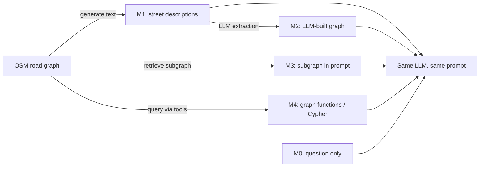

# Which Graph Representation Helps LLMs Answer Best?

**A Controlled Comparison of Graph Representations for LLM-based Question Answering, with Urban Road Networks as the Experimental Testbed**

| | |
|---|---|
| **Student** | Trần Phan Quốc Đạt (Student ID: 2470077) |
| **Degree** | Master's thesis — proposal |
| **Research area** | Retrieval-Augmented Generation (RAG), Graph RAG, LLM reasoning over graphs |
| **Application domain** | Transportation — urban road networks |
| **Version** | Draft for supervisor discussion, November 2026 |

> **Conventions used in this document.** Statements about prior work are cited as [n] and listed in the References section. Items marked **Hypothesis** are predictions to be tested, not results. Items marked **Planned** are design choices or estimates that will be finalized during the project.

---

## Abstract

Large language models (LLMs) are increasingly asked to answer questions whose underlying knowledge has a graph structure: road networks, knowledge graphs, organizational or citation networks. A growing family of *Graph RAG* methods proposes to expose this structure to the LLM, but recent systematic evaluations report that Graph RAG does not consistently outperform plain text-based RAG, and that its advantage depends on the type of question [1, 2, 4]. These studies, however, compare a small number of methods on different datasets and, crucially, on text corpora for which no ground-truth graph exists. This makes it impossible to tell whether a wrong answer is caused by a poorly constructed graph, by retrieval that missed the necessary information, or by the LLM failing to use information it was given.

This thesis proposes a controlled study that holds the knowledge fixed and varies only its representation. The testbed is the road network of Ho Chi Minh City extracted from OpenStreetMap [15]. This graph is real and has exact attributes, and the answers to questions about it can be computed algorithmically. The same network is presented to the same LLM in five ways: (M0) no retrieval, (M1) textual descriptions with text retrieval, (M2) a graph that an LLM-based Graph RAG framework builds from those descriptions, (M3) subgraphs retrieved from the original graph, and (M4) tools that query the graph directly. Performance is measured on a Vietnamese question set organized into five question types, from attribute lookup to route finding and global aggregation. Every answer is computed from the graph.

The study addresses four research questions: which representation works best for which question type and at what cost (RQ1); whether errors stem from missing information or from failure to use available information (RQ2); how far an LLM-constructed graph deviates from the true graph and how much that deviation explains wrong answers (RQ3); and whether these findings can be turned into a method that is more accurate, or cheaper, than the best single representation (RQ4). The expected outputs are an evidence-based guide for choosing a graph representation by question type, an error decomposition enabled by the ground-truth graph, a method designed from those findings and evaluated on held-out questions, and a Vietnamese road-network QA benchmark with verifiable answers.

---

## 1. Introduction and Motivation

### 1.1 Context

Retrieval-Augmented Generation (RAG) supplies an LLM with external information at inference time. In its standard form, documents are split into chunks, embedded, and the most similar chunks are added to the prompt. Graph RAG extends this idea by organizing knowledge as a graph of entities and relations, so that retrieval can follow connections between facts rather than relying on textual similarity alone. Representative systems include LightRAG [12] and HippoRAG 2 [13], which build a graph from documents with an LLM. Other lines of work retrieve subgraphs from an existing graph [7] or let the LLM generate formal queries over a graph database [11].

### 1.2 The problem

Choosing *how* to give graph-structured knowledge to an LLM is currently a matter of guesswork, because the evidence is mixed:

- GraphRAG-Bench (ICLR 2026) finds that basic RAG is comparable to or better than Graph RAG on fact-retrieval questions, while Graph RAG has an advantage on complex reasoning and summarization questions [1].
- Han et al. reach a similar conclusion: RAG performs better on single-hop and detail-oriented questions, Graph RAG on questions requiring reasoning [2].
- Chen et al. (GEM Workshop @ ACL 2026) compare nine RAG scenarios on a semi-structured biomedical knowledge base. The simplest variant, which appends one-hop relations to entity text, achieved the highest Hit@1 (0.6972). It outperformed both a hybrid Graph RAG setup (0.6422) and a setup using only the knowledge graph (0.1376). A graph extracted automatically by an LLM performed worse than plain text RAG (0.5596 vs 0.6147) [4].
- Even when the graph is given in full, the way it is written into the prompt matters: Fatemi et al. report that the choice of graph-to-text encoding changes accuracy on graph reasoning tasks by 4.8% to 61.8% depending on the task [5].

### 1.3 Why current evaluations cannot resolve it

A Graph RAG pipeline has several stages: building the graph, retrieving from it, and generating the answer. Most evaluations score only the final answer. GraphRAG-Bench characterizes the constructed graphs through structural statistics such as node count, average degree and clustering coefficient [1], and Chen et al. compare an extracted graph with a predefined one only through final accuracy [4]. Neither has a ground-truth graph for the corpus, so neither can measure directly what the extracted graph got wrong.

Chen et al. also document a *retrieval–generation gap*. Widening knowledge-graph retrieval raised the share of correct entities present in the context from 77.5% to 83.5%, but the share the LLM actually selected stayed between 45% and 48%. Entities that appeared only in the graph triples portion of the prompt were never selected [4]. This is consistent with the "lost in the middle" effect, where LLMs make poor use of information located in the middle of long contexts [16]. Diagnosing such failures requires knowing exactly which information was needed to answer each question.

### 1.4 Why road networks

Urban road networks are a natural testbed for this question, for three reasons:

1. **A ground-truth graph exists.** OSMnx downloads OpenStreetMap street networks as directed graphs with edge attributes such as street name, length, one-way flag and road class [15]. No LLM extraction is needed to obtain the reference graph.
2. **Answers are verifiable.** Answers can be computed by lookup, neighbor traversal, shortest-path algorithms or counting. MapQA generates geospatial QA pairs from OpenStreetMap with SQL templates in the same spirit [9].
3. **The questions are realistic and still hard.** On MapEval, no foundation model exceeded 67% accuracy, and all trailed human performance by more than 20%. Questions about distance, direction and route planning were among the hardest [8]. MapQA reports that retrieval-based methods struggle with questions requiring explicit computation [9].

Choosing a road network also anchors the thesis in the transportation domain while keeping the research question general: *which graph representation works best for which kind of question*.

---

## 2. Background and Related Work

### 2.1 Evaluating Graph RAG against standard RAG

| Work | Venue | Setting | Main finding relevant here |
|---|---|---|---|
| GraphRAG-Bench [1] | ICLR 2026 | Medical guidelines and novels; tasks from fact retrieval to creative generation | RAG ≥ Graph RAG on fact retrieval; Graph RAG better on complex reasoning and summarization. Evaluates graph construction, retrieval and generation separately |
| Han et al. [2] | arXiv (v3, 2026) | Unified evaluation protocol on standard QA and summarization benchmarks | RAG better on single-hop and detail questions, Graph RAG better on reasoning. Analyses biases of LLM-as-a-Judge in summarization evaluation |
| Zhou et al. [3] | PVLDB 2025 | 12 graph-based RAG methods in a four-stage unified framework | Controlled, component-wise comparison of graph RAG methods |
| Chen et al. [4] | GEM @ ACL 2026 | STaRK-Prime: entity text plus the PrimeKG biomedical knowledge graph; 9 scenarios | Text + one-hop relations is best on Hit@1; graph-only and LLM-extracted graphs underperform; retrieval–generation gap; context optimization reduces tokens by 19–53% |

**What this line of work leaves open.** These studies compare several methods, but each on its own corpus and without a ground-truth graph. The question types are also not aligned across studies, so their conclusions cannot be combined into a single picture of *representation × question type*.

### 2.2 How LLMs reason over graphs written as text

- **Talk like a Graph** (ICLR 2024) is a systematic study of graph-to-text encodings. It shows that performance depends on the encoding, the task and the graph structure, with encoding choice alone changing accuracy by 4.8–61.8% [5].
- **NLGraph** (NeurIPS 2023) poses 29,370 graph problems in natural language across eight tasks, from connectivity to shortest path and maximum flow. It finds that LLMs handle simple tasks, but the benefit of advanced prompting shrinks as problems become more complex [6].
- **G-Retriever** (NeurIPS 2024) retrieves a relevant subgraph from a textual graph by solving a Prize-Collecting Steiner Tree problem. This allows graphs larger than the context window and reduces hallucination [7].

**What this line of work leaves open.** [5] and [6] use small synthetic graphs that fit entirely in the prompt, so there is no retrieval problem to solve. Road networks of a city district are too large to be placed in the prompt and must be retrieved from.

### 2.3 Geospatial and map-based question answering

| Work | Venue | Data | Relevant finding or method |
|---|---|---|---|
| MapEval [8] | ICML 2025 | 700 multiple-choice questions, 180 cities | No model above 67%; all over 20% below humans; distance, direction and routing are hardest |
| MapQA [9] | arXiv 2025 | 3,154 QA pairs generated from OpenStreetMap with SQL templates; 9 question types | Retrieval methods capture closeness and direction but struggle with computation; LLM-generated SQL works for one-hop but struggles with multi-hop. Distance answers counted correct within 100 m |
| MapReason-OSM [10] | Preprint 2026 | OSM maps paired with a hidden street graph and exact oracle | Decisions are checked against the graph for validity, legality and optimality; models fail at cost reasoning on the graph |
| MapVerse [17] | WACV 2026 | Diverse real-world maps | Notes the limited depth of benchmarks that rely heavily on automatically generated content |

**What this line of work leaves open.** These benchmarks are in English and centred on the United States or on global points of interest. They evaluate models or one or two approaches, rather than comparing graph representations under controlled conditions. In Vietnamese, the available transportation NLP resources focus on traffic law and traffic signs, such as the VLSP 2025 MLQA-TSR challenge on Law No. 36/2024/QH15 [14].

### 2.4 Querying graphs with formal languages

CypherBench (ACL 2025) provides 11 large property graphs and more than 10,000 questions covering global, multi-hop, temporal and aggregation queries. It also contributes a pipeline for generating (question, Cypher) pairs from any Neo4j database [11]. Text-to-SQL over OSM-derived tables is studied in MapQA [9]. These works motivate representation M4, where the LLM delegates computation to the graph rather than reading the graph.

### 2.5 Summary of current knowledge

The table below organizes published findings by representation and question type. Each cell lists the source and the dataset it was obtained on. ✓ = good, ✗ = weak, ◐ = mixed or conflicting results, ? = no result found in the works surveyed.

| Representation | Lookup (≈ L1) | Relational / multi-step (≈ L2–L3) | Computation on the graph (≈ L4–L5) |
|---|---|---|---|
| Text + RAG | ✓ [1, 2] — medical, novels, open QA | ✗ [1, 2] — same | ✗ [9] — OSM, POIs |
| Text + one-hop relations | ✓ [4] — biomedical (not split by question type) | ✓ [4] — same | ? |
| LLM-built graph (Graph RAG) | ◐ [1] — medical, novels | ◐ [1, 4] — better than RAG in [1], worse than text RAG in [4] | ? |
| Existing graph → subgraph in prompt | ◐ [4, 5] — biomedical; synthetic graphs | ◐ [4, 5] — same | ◐ [6] — synthetic graphs |
| Graph queried through tools / SQL | ✓ [9] — OSM, one-hop | ✗ [9] — OSM, multi-hop | ? |

Two observations follow directly from this table. First, every cell comes from a different dataset, so the cells cannot be compared with each other. Second, several cells in the computation column have no result in the works surveyed.

---

## 3. Research Gap and Contributions

| # | Open problem | Evidence | How the thesis addresses it | Contribution |
|---|---|---|---|---|
| 1 | Each study compares only a few representations, each on its own dataset | [1, 4, 5, 9] | Compare all five representations on **one graph** with **one question set** stratified by question type | A guide for choosing a graph representation by question type, with accuracy and cost |
| 2 | Without a ground-truth graph, errors cannot be localized: graphs are assessed by structural statistics [1] or only through final accuracy [4] | [1, 4] | Use the true graph to know exactly which nodes and edges each question needs | An error decomposition: missing information · information present but not used · graph constructed incorrectly |
| 3 | Route and distance questions are a known weakness of LLMs [8]; Vietnamese transportation resources focus on law and signs [14] | [8, 14] | Build a Vietnamese question set over the road network, including routing and aggregation, with algorithmically computed answers | A reusable benchmark and generation pipeline, reproducible for other cities |
| 4 | The studies above report where each approach fails, and note that RAG and Graph RAG have complementary strengths [2], but the diagnosis is not carried through to a method that is tested under the same controlled conditions | [1, 2, 4] | Design a method from the findings of problems 1 and 2, and evaluate it on held-out questions against the best single representation | A method with measured gains in accuracy or cost, and an account of which diagnostic finding each design choice rests on |

---

## 4. Research Questions and Hypotheses

### RQ1 — Choosing a representation

> For each question type, which graph representation gives the highest accuracy, and at what cost?

- **Hypothesis H1.** On simple lookup questions (L1), text-based representation (M1) performs on par with graph-based ones. As questions require more steps or computation (L4–L5), representations that use the real graph (M3, M4) increasingly outperform the others.
- **Basis.** RAG ≥ Graph RAG on fact retrieval and Graph RAG > RAG on reasoning [1, 2]; retrieval methods struggle with computation questions [9].
- **Cost** covers prompt tokens, latency, and the time and tokens spent building indexes.
- **Answered by:** main experiment, plus ablations A3 and A4.

### RQ2 — Where errors come from

> When an answer is wrong, is it because the necessary information was not retrieved, or because the LLM had the information but failed to use it?

- *Necessary information* is the set of nodes and edges of the ground-truth graph needed to answer a question. It is known exactly for every question, because the questions are generated from the graph.
- **Hypothesis H2.** The harder the question, the larger the share of errors where the information was present but not used. Retrieving more information will not improve accuracy proportionally.
- **Basis.** Retrieval–generation gap: context coverage rose from 77.5% to 83.5% while the LLM's correct-selection rate stayed at 45–48% [4]; LLMs under-use information in the middle of long contexts [16].
- **Answered by:** ablation A1 (oracle information).

### RQ3 — Fidelity of LLM-built graphs

> When an LLM builds a graph from text (M2), how far does it deviate from the true graph, and how much of the answer error does that deviation explain?

- **Hypothesis H3.** The LLM-built graph will miss or distort edges, especially the direction of one-way streets. Questions that depend on such edges will have clearly lower accuracy.
- **Basis.** The LLM-extracted graph underperformed plain text RAG in [4]; graphs built by different frameworks differ substantially in structure [1].
- **Answered by:** ablation A2.

### RQ4 — From diagnosis to method

> Based on the findings of RQ1–RQ3, can a method be designed that achieves higher accuracy, or lower cost, than the best single representation?

- *Best single representation* is the one representation among M0–M4 with the highest overall accuracy on the question set, for a given LLM.
- **Hypothesis H4.** No single representation is best on every question type and on cost at the same time. A method that exploits this, by choosing or combining representations per question, will either exceed the overall accuracy of the best single representation, or match it at a lower average cost.
- **Basis.** RAG and Graph RAG have complementary strengths across question types [1, 2]; context optimization reduced prompt tokens by 19–53% in [4].
- **Answered by:** the method experiment (Section 5.5).

RQ1–RQ3 are diagnostic and RQ4 is constructive. For RQ1–RQ3, rejected hypotheses are valid findings: the value lies in measuring where each representation helps or fails, not in confirming a particular outcome. RQ4 carries the solution contribution of the thesis, and its method is designed only after the diagnostic results are available.

---

## 5. Methodology

### 5.1 Data: the road-network graph

- **Source.** OpenStreetMap, downloaded and converted to a directed graph with OSMnx [15].
- **Graph elements.** Nodes are intersections or dead ends with coordinates. Edges are directed street segments with attributes: `name`, `length`, `oneway`, `highway` (road class), and where present `lanes` and `maxspeed`.
- **Scope (Planned).** Start with one central district of Ho Chi Minh City, then extend to several districts for the scaling ablation.
- **Preprocessing (Planned).** Merge consecutive segments that share a street name, normalize Vietnamese street names (diacritics, abbreviations such as "Đường 3/2" vs "Ba Tháng Hai"), and use only attributes with sufficient coverage in the selected area.
- **Ground truth.** All answers are correct *with respect to OpenStreetMap*, not necessarily with respect to the real world. Since every representation draws on the same source, this does not bias the comparison, but it will be stated as a limitation.

### 5.2 Independent variable: five representations

All five representations draw on the **same knowledge**. The text used by M1 is generated automatically from the OSM graph. M2 rebuilds a graph from that text. M3 and M4 use the OSM graph directly.



| ID | Representation | What the LLM sees | Example input | Basis |
|---|---|---|---|---|
| **M0** | No retrieval | Only the question | — | Baseline for the LLM's own knowledge |
| **M1** | Text + RAG | Top-k street descriptions generated from the graph, each listing intersecting streets and attributes | "Lê Lợi Street: intersects Nguyễn Huệ, Pasteur…; two-way; about … m long" | Scenarios S1/S2 in [4] |
| **M2** | Graph RAG with LLM-built graph | A graph that the framework extracts from the M1 text, retrieved with the framework's own mechanism | (Lê Lợi) –intersects→ (Pasteur), extracted by the LLM | LightRAG [12], HippoRAG 2 [13] |
| **M3** | Subgraph from the original graph | The part of the OSM graph within k steps of the streets in the question, written as text | Lê Lợi –(intersects)– Pasteur; Pasteur –(one-way)→ … | S3/S5 in [4]; G-Retriever [7] |
| **M4** | Graph as a tool | Results of function calls or queries the LLM issues; computation is done by code | `shortest_path(A, B)`, `neighbors("Lê Lợi")`, Cypher | Text-to-SQL in [9]; text-to-Cypher [11] |

**How M2 works in this setting.** Graph RAG frameworks split the text into chunks and prompt an LLM to list entities and relations as triples, such as (Pasteur, is, one-way street) or (Pasteur, intersects, Lê Lợi). They then merge duplicate entities into a single graph and retrieve from that graph at question time [4, 12]. This mirrors the common real-world case where only documents exist, for example road-closure notices or operational documents. LightRAG has been used this way on an expressway-operations corpus [25]. In this thesis the true graph is deliberately withheld from M2 so that the LLM-built graph can later be compared against it.

**Controls.** The answer-generating LLM, the answering prompt, the output format and, where applicable, the context budget are held constant. Only the representation and retrieval change. This follows the "same conditions, one component changed" principle of [3, 4].

### 5.3 Question set

#### Question types

| Type | Name | Example (translated from Vietnamese) | Answer computed by | Answer form |
|---|---|---|---|---|
| L1 | Attribute | "Is Pasteur Street one-way?" | Reading the `oneway` attribute | Yes / No |
| L2 | Adjacency | "Which streets intersect Lê Lợi?" | Neighbor set of the edges named Lê Lợi | Set of street names |
| L3 | Multi-step, directional | "Going along Nguyễn Huệ towards the river, which street do you meet at the second intersection?" | Ordered traversal using geometry | Street name |
| L4 | Route | "What is the shortest legal route from intersection A to intersection B, and how long is it?" | Dijkstra on the directed graph | Street sequence + metres |
| L5 | Global aggregation | "How many one-way streets are in this area? Which street is the longest?" | Counting or extremum over the whole graph | Number / name |

The types are ordered by difficulty in the spirit of GraphRAG-Bench's levels, from retrieval to reasoning and aggregation [1]. L4 and L5 cover the computation-heavy questions that are weak spots in prior work [8, 9].

#### Generation pipeline

```
Template ──► Sample entities on the graph ──► Compute answer with code ──► LLM paraphrase ──► Human check
"Is [X] one-way?"   (X = a real street)        (exact ground truth)      (natural Vietnamese)
```

- **Templates** are question patterns with slots, written by the student for each type. Code fills the slots with real streets or intersections and computes the answer from the graph. This follows MapQA, which generates QA pairs from OSM with templates [9], and CypherBench, which generates (question, query) pairs automatically and rewrites them with an LLM [11].
- **Answers are never written by a person or an LLM.** They are always computed from the graph.
- **Paraphrasing** by an LLM makes questions sound natural and varied. Because rewriting can change the meaning, for example by reversing the direction of a relation, CypherBench re-verified rewritten questions in three LLM rounds and manually inspected its full test set [11]. This thesis includes an explicit human check of meaning preservation.

#### Size (Planned)

- **About 2,000 generated questions, 400 per type.** With 400 questions, the 95% confidence interval for accuracy within one type has a half-width of at most 1.96·√(0.25/400) ≈ ±4.9 percentage points (worst case p = 0.5).
- **About 100 free-form questions** written by a person who did not write the templates, so that the benchmark does not consist only of automatically generated content [17]. Their answers are also computed on the graph with code.
- **Development and test split.** The question set is split once, stratified by question type, into a development set and a held-out test set. The method of RQ4 is designed and tuned on the development set only, and its reported results come from the test set. The split ratio will be fixed before the main experiment.
- Pairwise comparisons between representations on the same questions will use McNemar's test for paired proportions [24], following standard guidance on significance testing in NLP [23].

#### Quality control (Planned)

- **Two independent annotators** (the student and one person not involved in creating the data) review a stratified random sample of 10% of generated questions (about 200) against three criteria:
  1. the question reads naturally in Vietnamese;
  2. it is unambiguous and has a single correct answer;
  3. the paraphrase preserves the meaning of the template.
- Inter-annotator agreement is reported with Cohen's κ [22].
- The thesis reports the share of questions that had to be fixed or removed, together with κ.
- Answer correctness is ensured by computation. Unit tests on small hand-checked subgraphs verify the answer-generation code.

### 5.4 Experiments

#### Main experiment (RQ1)

| Factor | Levels |
|---|---|
| Representation | M0, M1, M2, M3, M4 |
| Question type | L1–L5, about 400 questions each |
| LLM (Planned) | 2–3 open-weight models served locally, including at least one small (~7–8B) and one larger model |
| Scale (Planned) | ≈ 2,000 questions × 5 representations × 3 LLMs ≈ 30,000 runs |

The output is the *representation × question type* accuracy table for each LLM, together with cost measurements.

#### Ablations

| ID | Ablation | Purpose | RQ | Basis |
|---|---|---|---|---|
| A1 | **Oracle information**: insert exactly the required nodes and edges into the prompt | Upper bound on reasoning. The gap between oracle and each representation is the error due to retrieval | RQ2 | Separating retrieval coverage from usage as in [4] |
| A2 | **LLM-built graph vs OSM graph**: align M2's graph to the true graph | Count missing edges, spurious edges and wrong directions. Compute accuracy on questions that depend on affected edges | RQ3 | [4] compared extracted and predefined graphs only through accuracy |
| A3 | **Serialization format**: triples, relation-grouped lines, or prose; M1 with vs without intersecting-street lists | Effect of how the graph is written into the prompt | RQ1 | Encoding changes accuracy by 4.8–61.8% [5]; adding one-hop relations raised Hit@1 from 0.61 to 0.70 in [4] |
| A4 | **Graph size**: one district → several districts | Which representation degrades fastest as the graph grows | RQ1 | Scalability analysis in [1] |

### 5.5 Proposed method (RQ4)

The method is designed after the main experiment and the ablations, so that each design choice rests on a measured finding. The final design is therefore **Planned**. Three candidate directions are defined in advance, one per diagnostic research question:

| Candidate | Built on | Idea | Targets |
|---|---|---|---|
| **A. Adaptive routing** | RQ1 | Classify the question, send it to the cheapest representation that is accurate enough for its type, and fall back to a stronger representation when the answer is not reliable | Cost and latency at equal accuracy; accuracy where representations are complementary |
| **B. Evidence-aware context construction** | RQ2 | Prune and order the retrieved subgraph with respect to the question, so that the LLM uses the information it is given | Accuracy of M3; prompt tokens |
| **C. Verified graph construction** | RQ3 | Constrain LLM extraction with a schema and re-check directed edges, to repair the errors measured in A2 | Accuracy of M2 |

- **Selection (Planned).** The candidates are not ranked in advance. The direction is chosen after the pilot results, by the following conditions:
  - Candidate C is chosen if the pilot shows that the LLM-built graph (M2) makes a substantial number of edge-direction errors on naturally written text. It applies to the setting where only documents exist: M3 and M4 require a ground-truth graph, so M1 and M2 are the only representations available there, and RQ4 is then scoped to that setting.
  - Otherwise candidate A is chosen in a narrowed form: graph tools (M4) are part of the routing space, router labels are derived from ground-truth evidence, and the method is also evaluated on the free-form questions.
  - Candidate B is not pursued on its own. It is used as a component of A or C.
- **Novelty check.** A literature survey of the three directions is in `docs/rq4_method_directions_survey.md`. It informs the conditions above and the per-question fields below.
- **Per-question records.** So that any direction can be developed without regenerating the benchmark, every question records its ground-truth nodes and directed edges, whether its answer depends on edge direction, its structural features (number of hops, whether computation is required), and its entity-linking difficulty (duplicate or abbreviated names). Every run records correctness, tokens, number of LLM calls and latency for each question under each representation.
- **Evaluation protocol.**
  1. The method is developed on the development set and evaluated once on the held-out test set (Section 5.3).
  2. It is compared with every single representation M0–M4 on the same test questions, for accuracy and for cost, with McNemar's test for paired accuracy differences [24].
  3. For candidate A, an *oracle router* that picks the best representation for each question in hindsight gives the upper bound on what routing can achieve. It is computed from the main-experiment results.
  4. Each component of the method is removed in turn to show that it contributes.
  5. Generalization is checked on a second district that was not used during development (Planned).

---

## 6. Evaluation Metrics

All metrics below have been used in prior published work. Because ground-truth answers *and* ground-truth evidence come from the graph, they can be computed exactly rather than estimated by an LLM.

| What is checked | Metric | Applies to | Previously used in | Adaptation in this thesis |
|---|---|---|---|---|
| Correct or not | Exact match / accuracy | L1, L3, L5 | NLGraph [6], Talk like a Graph [5], MapEval [8], MapQA [9] | — |
| Multiple correct answers | F1 over the answer set | L2 | RoG on WebQSP and CWQ [20] | Partial credit instead of all-or-nothing |
| Numeric distance | Correct within a tolerance (metres) | L4 (route length) | MapQA: correct if within 100 m [9] | Also report relative error |
| Route correctness | Valid path, optimal path, partial credit | L4 (route) | NLGraph for shortest path [6]; validity / legality / optimality in MapReason-OSM [10] (preprint) | Add a legality check: no travel against one-way streets |
| Is the necessary information present? | Evidence recall | RQ2 | GraphRAG-Bench [1]; claim recall in RAGChecker [18]; context recall in RAGAS [19] | Computed exactly from the ground-truth graph |
| Is the information used? | Context utilization | RQ2 | RAGChecker [18]; retrieval vs selection rates in Chen et al. [4] | Computed exactly from the ground-truth graph |
| Is the built graph correct? | Precision / recall / F1 of edges against the reference | RQ3 | Text2KGBench (triples vs ground truth) [21]; subgraph Jaccard similarity in CypherBench [11] | Add the rate of wrong one-way directions |
| Cost | Prompt tokens, latency, index-building time and tokens | RQ1 | GraphRAG-Bench [1], Zhou et al. [3], Chen et al. [4] | — |

**Error decomposition (RQ2).** For each question, the pipeline is traced as a funnel:

```
Question ──► entities linked correctly? ──► necessary information in context? ──► LLM uses it correctly? ──► correct answer
                  (entity linking error)          (retrieval error)                    (usage error)
```

For M2, an additional stage, graph construction error, is identified through A2.

**LLM-as-a-judge is not used as a primary metric.** Every question has an algorithmically computed answer. Han et al. analyse biases of LLM-as-a-Judge when it is used to score summaries [2].

---

## 7. Expected Contributions

1. **A controlled comparison** of five graph representations for LLM question answering on one real graph and one stratified question set, resulting in a guide for choosing a representation by question type, with accuracy and cost.
2. **An error decomposition** enabled by the ground-truth graph, separating entity-linking, retrieval, usage and graph-construction errors.
3. **A direct measurement of LLM-built graph fidelity** against a reference graph, linked to downstream answer errors.
4. **A Vietnamese road-network QA benchmark** with verifiable answers and a generation pipeline that can be reproduced for other cities.
5. **A method derived from the diagnostic findings**, evaluated on held-out questions against the best single representation, with its gain in accuracy or cost and the contribution of each component.

Contributions 1–4 do not depend on which hypotheses are confirmed. If structured representations win clearly on hard questions, the study quantifies when and by how much. If simple text with relations performs as well, as observed in [4], the study tests that finding in a new domain and identifies where it breaks down. Contribution 5 is the solution contribution of the thesis. It depends on the diagnostic results, which is why three candidate directions are defined in advance (Section 5.5).

---

## 8. Risks and Mitigations

| Risk | Mitigation |
|---|---|
| OSM attributes for Ho Chi Minh City are incomplete or inconsistent | Survey attribute coverage in Phase 1; use only attributes with adequate coverage; state "correct with respect to OSM" as a limitation |
| Template questions sound unnatural | LLM paraphrasing, human review, and a free-form human-written subset [17] |
| Vietnamese street-name matching (diacritics, abbreviations, duplicate names across districts) | Name normalization module; report entity-linking errors separately |
| Paraphrasing changes question meaning | Explicit meaning-preservation check during human review, following the issue reported in [11] |
| Cost of building Graph RAG indexes with local LLMs | Limit graph size for M2 if necessary; report index-building time and tokens as results [1] |
| One representation dominates everywhere, making the main result look obvious | Shift emphasis to failure analysis (ambiguous questions, name matching, multi-hop) and to the cost–accuracy trade-off |
| One representation, most likely M4, dominates on accuracy, leaving no room for the RQ4 method to improve accuracy | Target cost and latency with candidate A, or the documents-only setting with candidate C, where M3 and M4 are not available |
| The RQ4 method overfits the benchmark it was designed on | Development and test split fixed before the main experiment; generalization check on a second district |
| The chosen method direction turns out not to be novel | Literature survey before the design is fixed; three candidate directions defined in advance |

---

## 9. Timeline (Planned)

| Weeks | Phase | Deliverable |
|---|---|---|
| 0–4 | Graph construction and OSM survey | Cleaned graph, attribute-coverage report, final geographic scope |
| 3–10 | Question set construction and validation | Templates, ~2,000 questions, human-review results and κ |
| 7–14 | Implementation of M0–M4 | Working pipelines; preliminary results on ~200 questions (checkpoint to confirm the design) |
| 14–20 | Main experiment and ablations | Full results tables, error analysis |
| 18–24 | Method design and evaluation (RQ4) | Method, test-set comparison with M0–M4, component ablation |
| 22–28 | Analysis and writing | Thesis manuscript; optional paper draft |

---

## 10. Scope and Limitations

- **Single city, static data.** The study uses one city's road network and no real-time traffic. Dynamic data (congestion, incidents) is outside the scope.
- **OSM as ground truth.** Answers are correct with respect to OpenStreetMap.
- **Generated questions.** Most questions come from templates. This is mitigated by paraphrasing, human review and a free-form subset, but not eliminated.
- **Generalization.** Findings are established on a road network: a graph that exists independently of text and has precise geometry. Transfer to other graph types, such as large knowledge graphs, is not claimed.
- **Model coverage.** Only a few open-weight LLMs are evaluated, due to compute constraints.

**Possible extension** if time permits: combining the road graph with traffic-law constraints, such as vehicle restrictions under Law No. 36/2024/QH15 [14].

---

## References

[1] Z. Xiang et al. *When to Use Graphs in RAG: A Comprehensive Analysis for Graph Retrieval-Augmented Generation* (GraphRAG-Bench). ICLR 2026. arXiv:2506.05690.

[2] H. Han et al. *RAG vs. GraphRAG: A Systematic Evaluation and Key Insights.* arXiv:2502.11371 (v3, 2026).

[3] Y. Zhou et al. *In-depth Analysis of Graph-based RAG in a Unified Framework.* PVLDB 18(13), 2025.

[4] L. Chen et al. *Is GraphRAG Needed? From Basic RAG to Graph-/Agentic Solutions with Context Optimization.* GEM Workshop @ ACL 2026. arXiv:2606.25656.

[5] B. Fatemi, J. Halcrow, B. Perozzi. *Talk like a Graph: Encoding Graphs for Large Language Models.* ICLR 2024.

[6] H. Wang et al. *Can Language Models Solve Graph Problems in Natural Language?* (NLGraph). NeurIPS 2023.

[7] X. He et al. *G-Retriever: Retrieval-Augmented Generation for Textual Graph Understanding and Question Answering.* NeurIPS 2024.

[8] M. L. Dihan et al. *MapEval: A Map-Based Evaluation of Geo-Spatial Reasoning in Foundation Models.* ICML 2025.

[9] Z. Li et al. *MapQA: Open-domain Geospatial Question Answering on Map Data.* arXiv:2503.07871, 2025.

[10] S. Venkatanarayanan, C. P. Isaac. *MapReason-OSM: Graph-Verifiable Mobility Decisions from Street Maps.* Preprint, 2026.

[11] Y. Feng, S. Papicchio, S. Rahman. *CypherBench: Towards Precise Retrieval over Full-scale Modern Knowledge Graphs in the LLM Era.* ACL 2025.

[12] Z. Guo et al. *LightRAG: Simple and Fast Retrieval-Augmented Generation.* Findings of EMNLP 2025.

[13] B. J. Gutiérrez et al. *From RAG to Memory: Non-parametric Continual Learning for Large Language Models* (HippoRAG 2). arXiv:2502.14802, 2025.

[14] S. T. Luu et al. *VLSP 2025 MLQA-TSR Challenge: Vietnamese Multimodal Legal Question Answering on Traffic Sign Regulation.* VLSP 2025.

[15] G. Boeing. *OSMnx: New Methods for Acquiring, Constructing, Analyzing, and Visualizing Complex Street Networks.* Computers, Environment and Urban Systems 65, 2017.

[16] N. F. Liu et al. *Lost in the Middle: How Language Models Use Long Contexts.* TACL 2024.

[17] S. Bhat et al. *MapVerse: A Benchmark for Geospatial Question Answering on Diverse Real-World Maps.* WACV 2026.

[18] D. Ru et al. *RAGChecker: A Fine-grained Framework for Diagnosing Retrieval-Augmented Generation.* NeurIPS 2024 (Datasets and Benchmarks).

[19] S. Es et al. *RAGAs: Automated Evaluation of Retrieval Augmented Generation.* EACL 2024 (System Demonstrations).

[20] L. Luo et al. *Reasoning on Graphs: Faithful and Interpretable Large Language Model Reasoning.* ICLR 2024.

[21] N. Mihindukulasooriya et al. *Text2KGBench: A Benchmark for Ontology-Driven Knowledge Graph Generation from Text.* arXiv:2308.02357, 2023.

[22] J. Cohen. *A Coefficient of Agreement for Nominal Scales.* Educational and Psychological Measurement 20(1), 1960.

[23] R. Dror et al. *The Hitchhiker's Guide to Testing Statistical Significance in Natural Language Processing.* ACL 2018.

[24] Q. McNemar. *Note on the Sampling Error of the Difference Between Correlated Proportions or Percentages.* Psychometrika 12(2), 1947.

[25] *ExpressMind: A Multimodal Pretrained Large Language Model for Expressway Operation.* arXiv:2603.16495 (preprint).

> **Publication status.** [10] and [25] are preprints that have not been peer-reviewed. [2], [9], [13] and [21] are cited from their arXiv versions.
